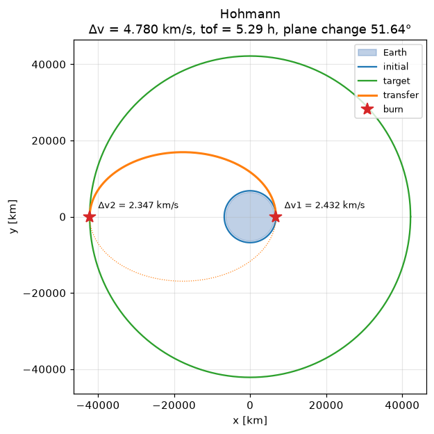

# urania

**An astrodynamics library that computes, shows and explains.**

urania is a Python library for orbital mechanics, written for university CubeSat teams, students, educators and
space enthusiasts: people who are serious about understanding and computing things in space without being
professional mission analysts. Every result can

- **compute**: SI numbers from pure, tested functions, validated against textbook examples, NASA GMAT and real missions;
- **show**: `.plot()` draws it;
- **explain**: `.explain()` prints the formulas, intermediate values and assumptions step by step.

```python
import urania as ur

transfer = ur.ISS.transfer_to(ur.GEO)
print(transfer.summary(mass="500 kg", isp="320 s"))   # Δv, burns, time and propellant
print(transfer.explain())                             # how it was computed
```



## Install

```text
pip install urania            # core
pip install "urania[msis]"    # + the NRLMSISE-00 atmosphere (pymsis)
```

Python 3.10 to 3.13.

## What it covers

| Area | Highlights |
|---|---|
| Orbits | state vectors ↔ elements, Kepler's equation (universal variables), presets (ISS, SSO, GEO) |
| Propagation | two-body, zonal harmonics J2–J6, drag (exponential or NRLMSISE-00), Sun and Moon, radiation pressure |
| Maneuvers | Hohmann, bi-elliptic, plane changes, Lambert rendezvous, phasing, deorbit, propellant mass |
| Interplanetary | 8 planets and 20 moons, patched-conic Hohmann, Lambert, porkchop plots, gravity assists |
| Operations | TLEs (SGP4), ground tracks, station passes, Doppler, eclipses, beta angle, footprint, lifetime |
| Frames and data | TEME ↔ GCRS/ITRS (astropy), CCSDS OEM export |

## Where to go next

- New to urania: [Getting started](getting-started.md), then `print(ur.cheatsheet())`.
- Learning orbital mechanics: the [tutorials](tutorials/01-orbits.md) follow the chapters of Curtis,
  *Orbital Mechanics for Engineering Students*, and reproduce its examples.
- Checking the numbers: [Validation](validation.md).
