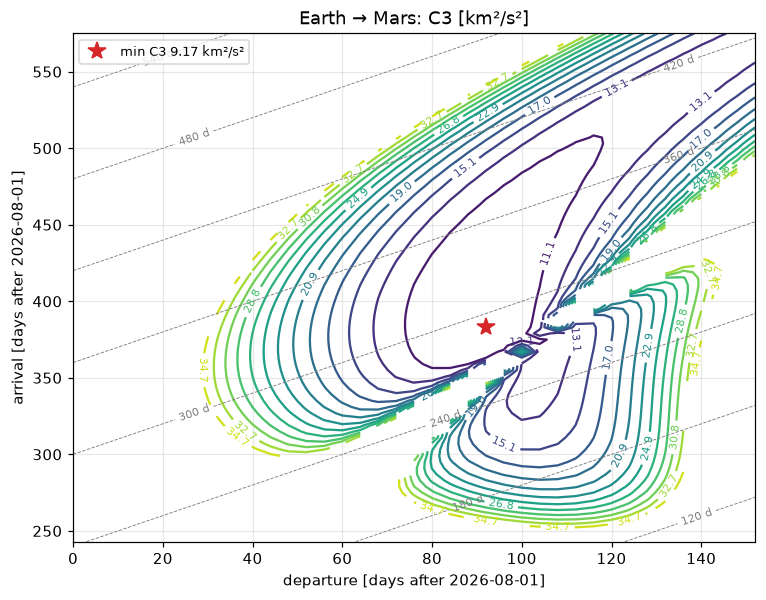

# 5. Interplanetary trajectories

*Curtis, chapter 8: patched conics, planetary departure and arrival, Lambert transfers between planets, flybys.*

## Hohmann transfer to Mars (Curtis Examples 8.2–8.4)

```python
import urania as ur

t = ur.Earth.hohmann_to("Mars", parking_altitude="300 km", capture_altitude="300 km", after="2026-01-01")
print(t.summary())
print(t.explain())
```

From a 300 km parking orbit the departure burn is 3.590 km/s (Curtis Example 8.3), the flight takes 259 days, Mars
must lead Earth by 44.3° at departure, and a return Hohmann has to wait 454 days at Mars. With `after=`, urania
finds the date on which the actual planet positions (JPL's Standish elements) reach that phase angle.

Moons work the same way: `ur.Earth.hohmann_to("Moon", ...)`, `ur.Io.hohmann_to("Europa", ...)`.

## Porkchop plots

Real launch windows come from Lambert's problem over a grid of departure and arrival dates:

```python
import urania as ur

p = ur.porkchop("Earth", "Mars", ("2026-08-01", "2027-01-01"), ("2027-04-01", "2028-03-01"), step="10 day",
                parking_altitude="300 km", capture_altitude="300 km")
print(p)
best = p.best("total_dv")
print(best.summary())
ax = p.plot()
```



## Gravity assists: Mariner 10

Mariner 10 left Earth on 1973-11-03, flew past Venus on 1974-02-05 and reached Mercury on 1974-03-29. With those
dates, the two Lambert legs need a Venus flyby at 5,739 km altitude (5,768 km was flown) and almost no burn:

```python
import urania as ur

m = ur.flyby_mission(["Earth", "Venus", "Mercury"],
                     ["1973-11-03 17:45", "1974-02-05 17:01", "1974-03-29 20:47"], parking_altitude="185 km")
print(m.flybys[0])
print(m.summary())
ax = m.plot()
```

When the incoming and outgoing v∞ differ, the flyby is "powered": a burn at periapsis makes up the difference,
and flybys below `min_flyby_altitude` are flagged infeasible. `ur.Jupiter.flyby(v_inf_in, altitude)` shows what a
single unpowered flyby does to the heliocentric speed.
