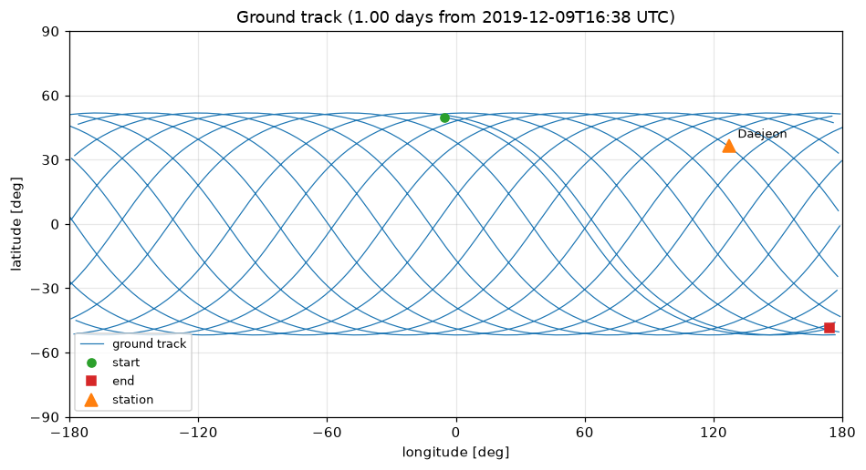
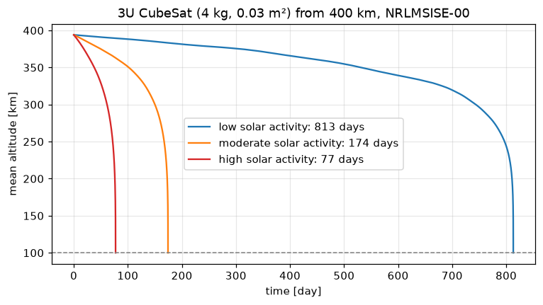

# 6. CubeSat operations

*From a TLE to the questions a CubeSat team asks every week: where is it, when can we talk to it, at what
frequency, is it in sunlight, and how long will it last?*

## From a TLE

TLEs are propagated with SGP4 (the model they were fitted with), separately from urania's own propagator:

```python
import urania as ur

iss = ur.TLEOrbit.from_text("""ISS (ZARYA)
1 25544U 98067A   19343.69339541  .00001764  00000-0  38792-4 0  9991
2 25544  51.6439 211.2001 0007417  17.6667  85.6398 15.50103472202482""")
day = iss.propagate(days=1)
print(day)
```

## Ground track and passes

```python
import urania as ur

iss = ur.TLEOrbit.from_text("""ISS (ZARYA)
1 25544U 98067A   19343.69339541  .00001764  00000-0  38792-4 0  9991
2 25544  51.6439 211.2001 0007417  17.6667  85.6398 15.50103472202482""")
day = iss.propagate(days=1)
station = ur.GroundStation.create("Daejeon", "36.37 deg", "127.36 deg", "70 m")
passes = day.passes(station, min_elevation="10 deg")
print(passes)
ax = day.ground_track().plot(stations=[station])
```



## Doppler shift

A 437.5 MHz downlink from low orbit shifts by up to ±10 kHz during a pass:

```python
import urania as ur

iss = ur.TLEOrbit.from_text("""ISS (ZARYA)
1 25544U 98067A   19343.69339541  .00001764  00000-0  38792-4 0  9991
2 25544  51.6439 211.2001 0007417  17.6667  85.6398 15.50103472202482""")
day = iss.propagate(days=1)
station = ur.GroundStation.create("Daejeon", "36.37 deg", "127.36 deg")
doppler = day.doppler(station, "437.5 MHz")
print(doppler)
ax = doppler.plot(min_elevation="0 deg")
```

## Sunlight: eclipses and the beta angle

```python
import urania as ur

orbit = ur.sun_synchronous("550 km", epoch="2026-06-21")
print(orbit.beta_angle(), orbit.eclipse_fraction())     # angle to the Sun, fraction of the orbit in shadow
report = orbit.propagate(days=1).eclipses()             # conical shadow with penumbra
print(report.shadow_fraction)
```

## Coverage

```python
import urania as ur

orbit = ur.Orbit.circular("Earth", "550 km")
print(orbit.footprint("10 deg"))             # area that can see the satellite above 10° elevation
print(orbit.footprint(half_angle="15 deg"))  # swath of a nadir camera
```

## Lifetime

The solar cycle changes the answer more than anything else, so try several activity levels:

```python
import urania as ur

orbit = ur.Orbit.circular("Earth", "400 km", inc="51.6 deg", epoch="2026-11-01")
for activity in ("low", "moderate", "high"):
    life = orbit.lifetime(area="0.03 m2", mass="4 kg", density=ur.NRLMSISE00(activity=activity))
    print(activity, life)
```



## Sharing the ephemeris

```python
import tempfile
from pathlib import Path
import urania as ur

tr = ur.Orbit.circular("Earth", "500 km", inc="97.4 deg", epoch="2026-11-01").propagate(hours=6, model="j2")
path = tr.to_oem(Path(tempfile.gettempdir()) / "cubesat.oem", object_name="CUBESAT-1")
print(path.read_text()[:400])
```

The file is a CCSDS Orbit Ephemeris Message in GCRF, readable by STK, GMAT and Orekit.
